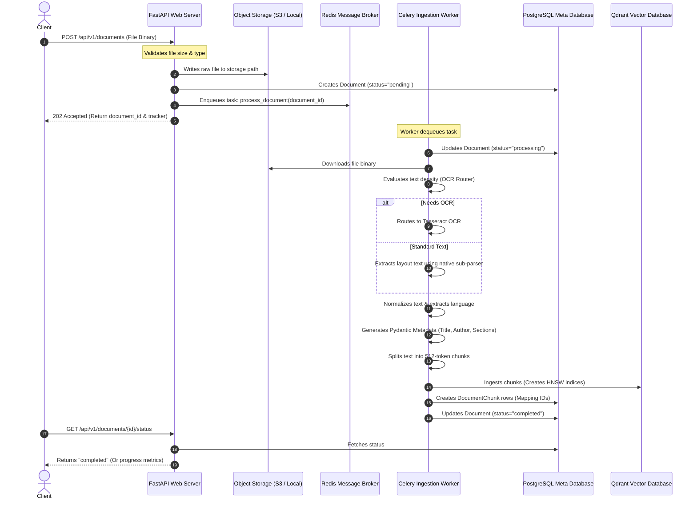

# DocsMind Platform: System Architecture Specification

## 1. Architectural Style & Design Principles
The DocsMind Platform backend is built using **Clean Architecture** combined with **Domain-Driven Design (DDD)** concepts. This modular structure enforces strict boundaries between different levels of the application:

*   **Domain Layer (`app/models`)**: Holds the core business entity schemas (User, Document, Chunks, Messages). This layer is independent of any outer frameworks or database access libraries.
*   **Infrastructure Layer (`app/db`, `app/services/storage`)**: Deals with raw technical operations: database connection pools, Redis connection setups, and S3 adapter operations.
*   **Repository Layer (`app/repositories`)**: Exposes database interfaces. Route handlers and business logic consume repositories rather than directly executing SQLAlchemy queries, keeping database operations isolated.
*   **Application Service Layer (`app/services`)**: Implements business transactions (e.g., authentication, parsing documents, chunk generation). It orchestrates repositories and infrastructure interfaces.
*   **Presentation Layer (`app/api`)**: FastAPI route controllers. Handles incoming requests, executes Pydantic schema validation, handles custom HTTP exceptions, and handles serialization.

---

## 2. Ingestion & Asynchronous Lifecycle
Document processing (parsing, OCR, metadata extraction, chunking, and indexing) is slow and CPU-heavy. To prevent web server blocking, all files are ingested asynchronously using a background queue.

---

## 3. Technology Stack & Integrations

*   **FastAPI**: Used for high-throughput asynchronous request routing, automated OpenAPI generation, and dependency injection.
*   **Celery + Redis**: Celery distributes parsing, OCR, and embedding pipelines across a horizontally scalable pool of background processes. Redis acts as the message broker.
*   **SQLAlchemy + Alembic**: Asynchronous database mapping using `asyncpg` for request routing, alongside sync migration scripts using `psycopg` (v3).
*   **Qdrant / Pinecone**: High-dimensional index database. Houses document chunk embeddings, enabling hybrid search queries with payload restrictions for multi-tenancy.
*   **PyMuPDF & pdfplumber**: PyMuPDF executes fast page-level bounding box extractions, while pdfplumber handles table identification.
