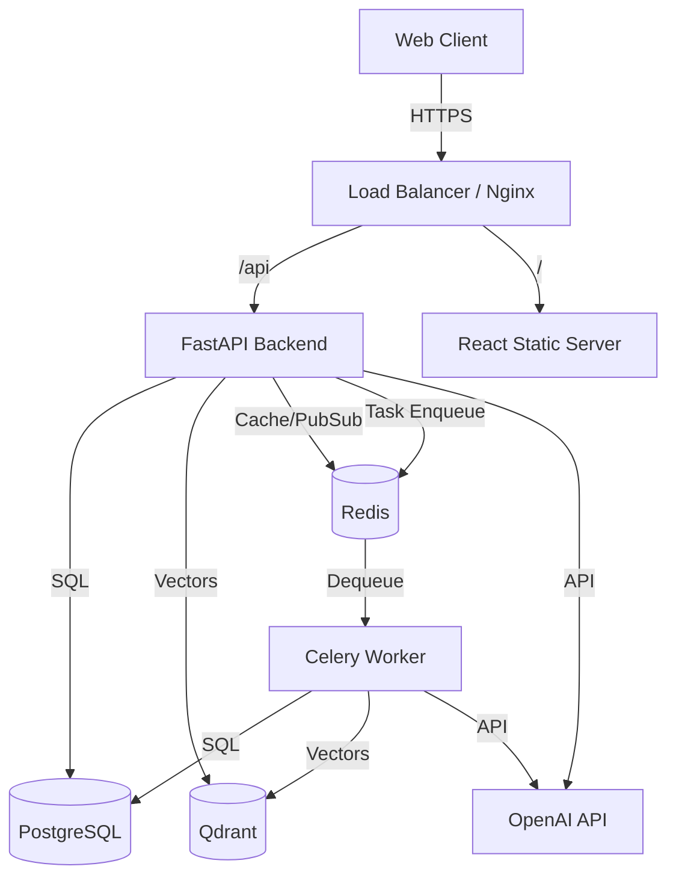
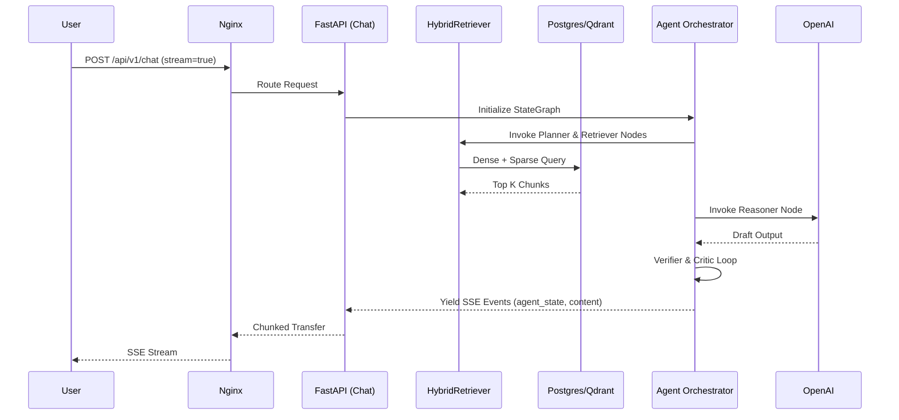
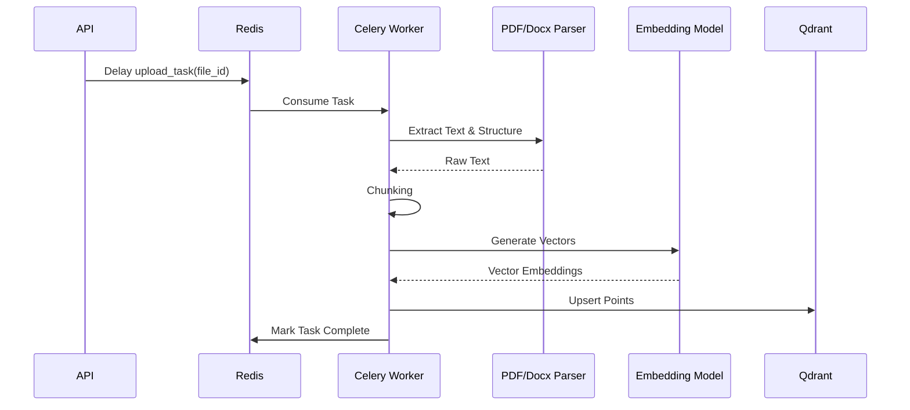
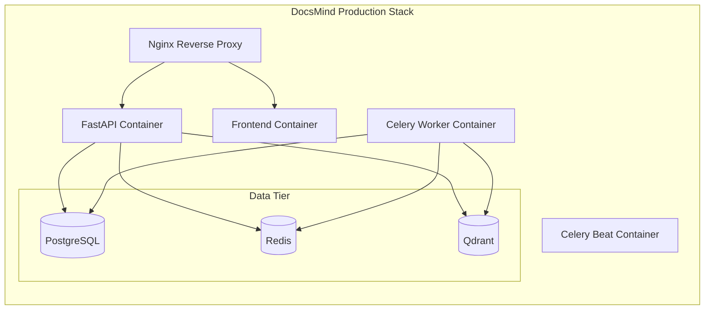

# Platform Architecture

DocsMind Version 1.0 is an enterprise-grade AI document intelligence platform designed for high availability, security, and scalability. This document details the infrastructure topology and request flows.

## 1. Service Diagram

## 2. Request Flow (Streaming RAG)

## 3. Background Worker Flow (Document Ingestion)

## 4. Deployment Topology (Docker Compose)

