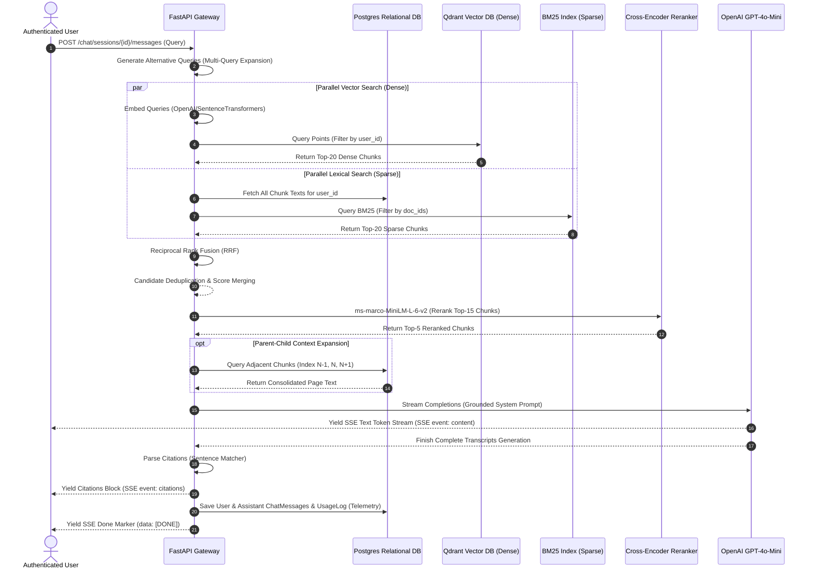

# DocsMind RAG Ingestion & Retrieval Pipeline

This document details the architectural specifications, algorithmic designs, and retrieval strategies governing the **DocsMind Enterprise RAG Engine**.

---

## 1. System Architecture Diagram



---

## 2. Retrieval Strategies Compared

We combine **Dense Semantic Retrieval** and **Sparse Lexical Retrieval** to gain the advantages of both:

| Metric | Dense Retrieval (Qdrant) | Sparse Retrieval (BM25) | Hybrid Retrieval (RRF + Reranker) |
| :--- | :--- | :--- | :--- |
| **Search Mechanism** | Vector Cosine Similarity (bi-encoder mappings) | Term Frequency-Inverse Document Frequency (tf-idf log curves) | Rank-based score fusion followed by a deep attention-based cross-encoder |
| **Strengths** | Captures synonyms, conceptual relationships, and semantic meanings. | Matches exact keywords, codes, names, product serials, and rare nouns. | Combines semantic meanings with exact-word precision. |
| **Weaknesses** | Poor at matching specific alphanumeric codes, serial numbers, or rare tags. | Fails to match synonyms (e.g., "automobile" vs "car") or capture abstract topics. | Requires more computation (embedding generation + cross-encoder inference). |
| **Latency Profile** | Low-medium (dependent on vector index lookup speed). | Extremely low (runs locally in-memory over tenant-filtered chunks). | Medium (includes parallel lookups and cross-encoder prediction latency). |

### Why Reciprocal Rank Fusion (RRF) is Used
Standard dense and sparse retrieval engines output scores in different ranges (e.g., dense outputs Cosine similarity `[0.0, 1.0]`, while sparse BM25 outputs log-based relevance `[0.0, 30.0+]`). Directly normalizing and summing these scores is problematic because one engine's distribution can easily overwhelm the other.

**RRF** resolves this by fusing the *ranks* of the documents rather than their raw scores:

$$RRF\_Score(d \in D) = \sum_{m \in M} \frac{1}{k + r_m(d)}$$

Where $r_m(d)$ is the 1-based rank of document $d$ inside retrieval engine $m$, and $k$ is a constant (typically $60$) that dampens the influence of outlier high rankings from a single engine. RRF is dialect-agnostic, requires no training, and consistently outperforms single-engine retrievers.

---

## 3. Contextual Reranking & Adjacent Chunk Windowing

### 1. Cross-Encoder Reranking
Dense bi-encoders embed queries and documents separately, which is fast but misses cross-token interactions. DocsMind feeds the top fused candidates into `cross-encoder/ms-marco-MiniLM-L-6-v2`. A Cross-Encoder processes the query and passage *together* through all self-attention layers, yielding highly accurate relevance scores. We only feed the top-15 fused chunks into the reranker to keep latency low.

### 2. Parent-Child Adjacent Context Enrichment
Dividing documents into small chunks (e.g., 512 characters) helps the vector database match specific facts. However, small chunks lack the surrounding context that LLMs need to generate complete answers.
DocsMind resolves this using **Adjacent Chunk Windowing**:
*   Once the top-K chunks are identified, the retriever fetches the adjacent chunks (`N-1` and `N+1`) from Postgres.
*   The three chunks are merged in chronological order to reconstruct the surrounding page context, which is then sent to the LLM.

---

## 4. Chunking Strategy Trade-offs

Choosing a chunking strategy involves balancing retrieval precision with context size:

```
+---------------------------------------------------------------------------------------+
|                              CHUNKING COMPARISONS                                     |
+-------------------+-----------------------+-------------------+-----------------------+
| Strategy          | Strengths             | Weaknesses        | Optimal Use Case      |
+-------------------+-----------------------+-------------------+-----------------------+
| Recursive         | Retains structural    | Can slice text    | Generic PDFs, long    |
| Character         | paragraphs & sentences| mid-sentence if   | reports, and          |
|                   | within token limits.  | limits are tight. | manuals.              |
+-------------------+-----------------------+-------------------+-----------------------+
| Token-Based       | Guarantees precise    | Ignores sentence  | Strict context size   |
| (tiktoken)        | context sizes.        | boundaries.       | budget controls.      |
+-------------------+-----------------------+-------------------+-----------------------+
| Markdown-Aware    | Keeps sections and    | Breaks if MD is   | Developer wikis,      |
|                   | headers grouped.      | poorly formatted. | READMEs, static docs. |
+-------------------+-----------------------+-------------------+-----------------------+
```

---

## 5. Technical Q&A — RAG Engine Design

*   **Q: Why does DocsMind initialize Qdrant with `_shared_client` in-memory during testing, and how does this affect testing concurrency?**
    *   **Expected Answer:** By default, `QdrantClient(":memory:")` creates a private, isolated database instance. During eager Celery tests, the background task worker and the web client run on separate threads. If they initialize separate `:memory:` clients, the worker will write vectors to an instance that the retriever cannot query. Storing a class-level singleton client (`_shared_client`) ensures both threads share the same memory space, enabling reliable end-to-end integration tests.
*   **Q: How do we prevent hallucinations when a query cannot be answered by the retrieved documents?**
    *   **Expected Answer:** We enforce grounding through system prompts and strict instructions. The system prompt contains the retrieved context chunks and explicitly instructs the LLM: *'If the context does not contain the answer, state: "I cannot find the answer to this question in the uploaded documents." Do not extrapolate or introduce outside facts.'* The prompt also requires bracketed citations (e.g. `[1]`, `[2]`), making it easy to verify the model's sources.
*   **Q: Why is the Cross-Encoder model loaded lazily and run in a separate thread pool (`asyncio.to_thread`)?**
    *   **Expected Answer:** Cross-Encoder models contain millions of parameters, making model loading slow. Loading the model lazily avoids slowing down application startup. Additionally, model inference (`predict()`) is a synchronous, CPU-bound operation. Running it directly inside an async route would block FastAPI's single-threaded event loop, delaying all other concurrent requests. Offloading it via `asyncio.to_thread` runs it in Python's default thread pool, keeping the server responsive.
