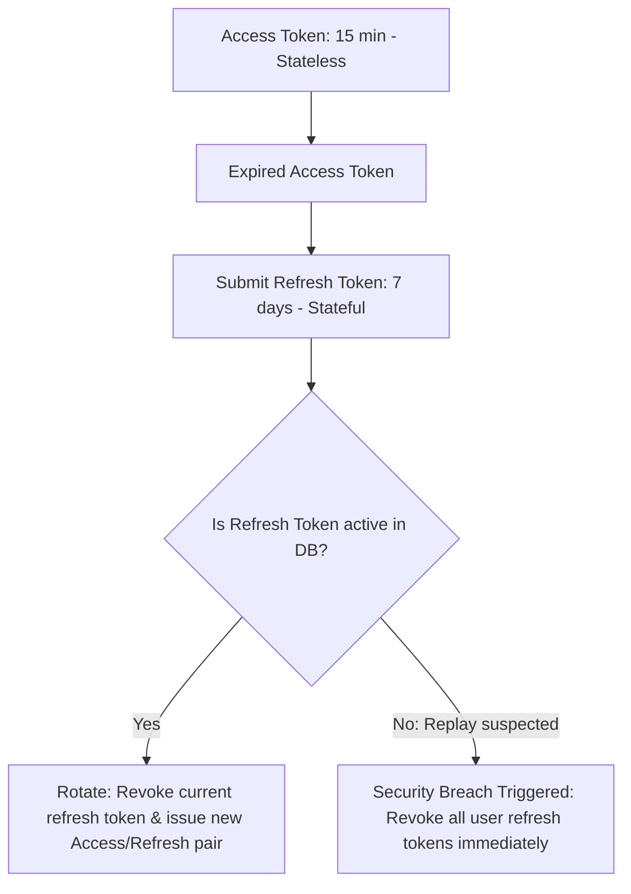

# DocsMind Security Architecture Specification

DocsMind enforces enterprise-grade security protocols across all layers of the application stack.

---

## 1. Identity Management & Session Controls

### Stateful Refresh Token Rotation (RTR)
RTR prevents refresh token reuse. The session lifecycle is structured as follows:



To prevent performance bottlenecks on transactional tables, revoked Refresh Token `jti` identifiers are cached in Redis for their remaining TTL.

---

## 2. Multi-Tenant Resource Isolation

### Relational Database Level
Every SQL query targeting documents, chunks, or chat sessions includes a parameterized tenant constraint:
```sql
SELECT * FROM documents WHERE id = :document_id AND user_id = :current_user_id;
```

### Vector Database Level
Multi-tenancy inside the vector space is enforced using collection-level filtering. Every vector written is tagged with a `user_id` payload attribute. Queries must apply a matching filter:
```json
{
  "filter": {
    "must": [
      { "key": "user_id", "match": { "value": "a1b2c3d4-..." } }
    ]
  }
}
```

---

## 3. Web Vulnerability Protections

*   **Rate Limiting**: Configured using a sliding-window token bucket algorithm in Redis. Capped at 5 requests/minute for unauthenticated auth endpoints (login/register) to prevent brute-force attacks, and 120 requests/minute for authenticated endpoints.
*   **Input Sanitization & XSS Prevention**: FastAPI validates inputs against Pydantic schemas. The React client escapes rendered string templates by default and uses `DOMPurify` for rendering HTML content (e.g., source highlights).
*   **SQL Injection Prevention**: Forced database parameterized execution via the SQLAlchemy ORM. Raw SQL executions are prohibited.
*   **Prompt Injection Safeguards**: Grounding filters parse input prompts, stripping system-control tokens (e.g., `[SYSTEM]`, `ignore instructions`). Query payloads are enclosed in XML tags (`<query>...</query>`) inside system prompts.
